# TickFit

**A free, open-source gym and meal tracker that lives on your phone.** Turn any workout and meal plan into a daily checklist, log every set, and let it tell you when to go heavier. Track personal records, calories, weight, body measurements, progress photos and steps. Get a grocery list for the week, swap meals, scan packets, and share a plan with a friend as a QR code. Three looks that each feel like their own app: **Arena** (your day is a match), **Deck** (one card at a time) and **Bento** (soft tiles), plus a website, an Android app with reminders and home screen widgets. **No account, no backend, no tracking, no subscription.** Everything stays on your device and it works fully offline.

**[Open the web app](https://predatorwoah.github.io/TickFit/)** · **[Download the Android app](https://github.com/PredatorWoah/TickFit/releases/latest)** · [Privacy](PRIVACY.md) · [Contribute](CONTRIBUTING.md)

> Built to share with friends so nobody has to pay for a fitness app. Plain HTML, CSS and JavaScript with no build step, so anyone can read it, fork it and change it.

<p>
  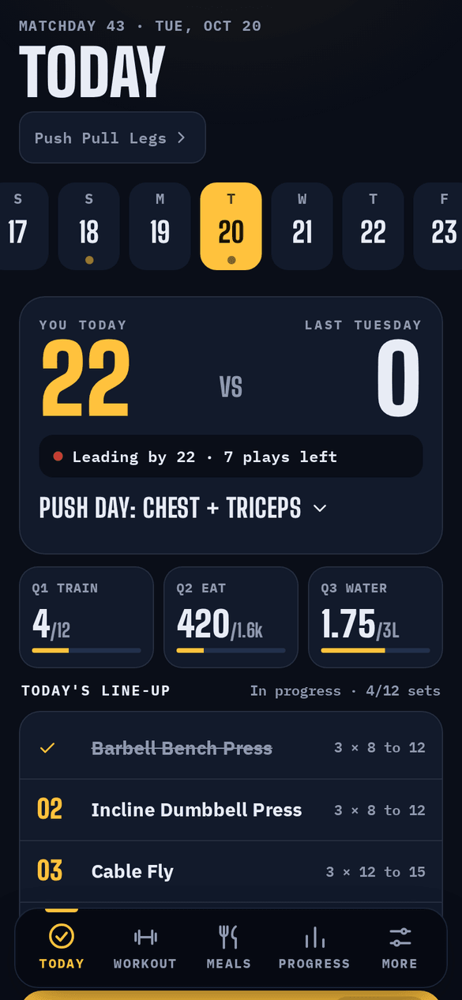
  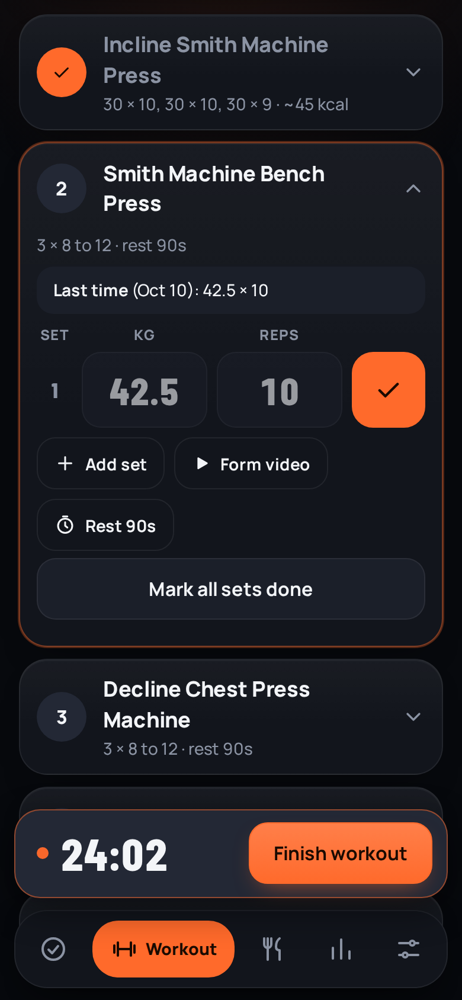
  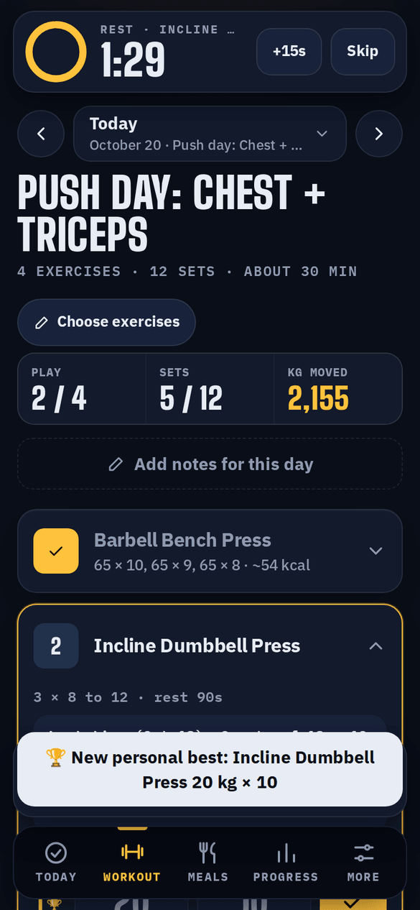
</p>
<p>
  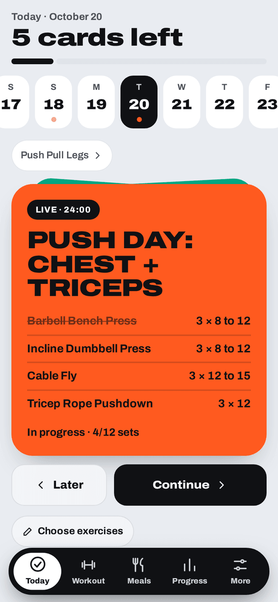
  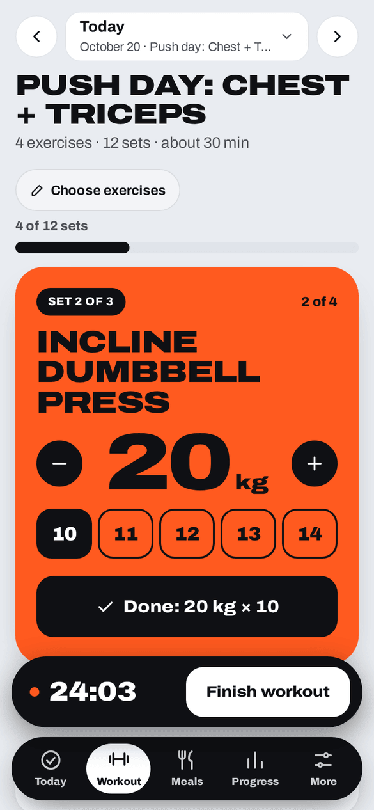
  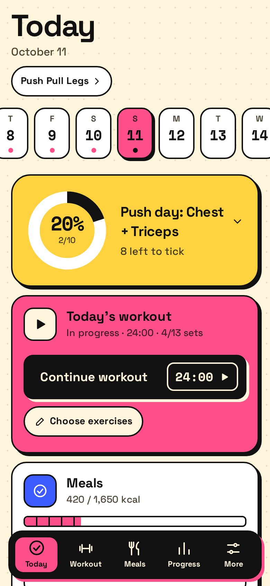
</p>
<p><em>Top: Arena, the default. Bottom: Deck, and the redesigned Bento. Switch any time in More > Look.</em></p>

## What it does

### Train

- **Today, three ways:** **Arena** is a scoreboard: you today against the same day last week, four quarters (train, eat, water, steps), a replay tip from last time, the line-up and one big **Kick off**. **Deck** shows only the next thing to do as one big card: swipe it right (or tap the button) to tick it, left for later, with Undo. **Bento** is a grid of soft tiles: the day ring, streak, workout, meals, water and weight. Every look has the week strip with completion dots; tap the day title to jump to any day of the plan. New to a look? Tap **?** at the top right for a guided tour: the screen dims and each part lights up with what it means and what tapping or swiping it does (in Deck the card even shows its swipe).
- **Workout mode:** one screen, no pop-ups. Every exercise is listed, the one you are on is open with a row for each set and big weight and reps boxes. Tick a set and the next exercise opens by itself. A clock runs while you train (it even starts on your first ticked set), and **Finish workout** shows your time, sets and total weight lifted. Boxes are pre-filled from the last time you did that exercise ("Last time (Sep 27): 3 sets of 22.5 × 10").
- **Rest timer:** starts by itself after each finished set (you can switch that off), with +15s, skip, beep and vibration. It sits at the top of the screen and pushes the page down instead of covering it. In the Android app it also alerts you with a notification when the screen is off or you switched apps.
- **Go heavier hints:** hit the top of the rep range on every set last time? The exercise says "Try 42.5 kg today" with a one-tap **Use 42.5 kg**. Fell short? It tells you to stay and chase the reps.
- **Plates and warm-ups:** **Plates** shows what to load on each side (20, 15 or 10 kg bar, or none), with a little picture. **Warm-up** shows a ramp (about 50%, 70% and 85%) before your working weight.
- **Personal records:** a set that beats your best (weight and reps together, as an estimated 1 rep max) gets a trophy and a cheer. Progress lists your records; tap one, or any exercise in the strength list, for its chart over time.
- **Supersets:** tap **Superset with next** to pair exercises. TickFit then moves between them without resting and starts the rest after the last one. Plans can also say `"superset": "A"`.
- **Form videos:** each exercise can carry a video link. If it doesn't, the **Form video** button opens a YouTube search for that exercise.
- **Notes you can edit:** the day's notes on the Workout screen are laid out as a tidy list (labels in bold, safety warnings in their own box) and collapse when long. Tap the pencil to edit them, hit **Tidy up into points** to auto-arrange your own text, and choose to save for just that day or every day that has the same note.
- **Reminders (Android app):** **More > Reminders** can nudge you at your workout time on workout days, at each meal's time from the plan, and for water every few hours until you reach the day's target. They skip rest days and anything you already ticked.

<p>
  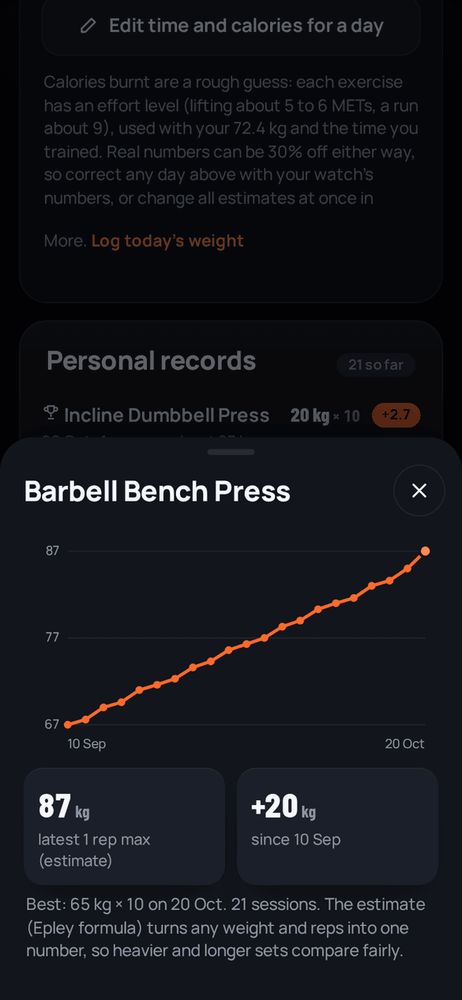
  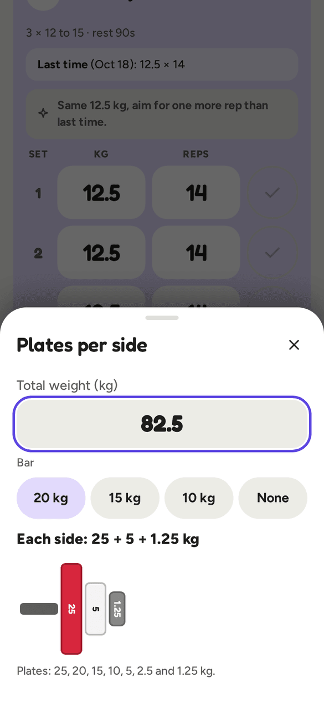
  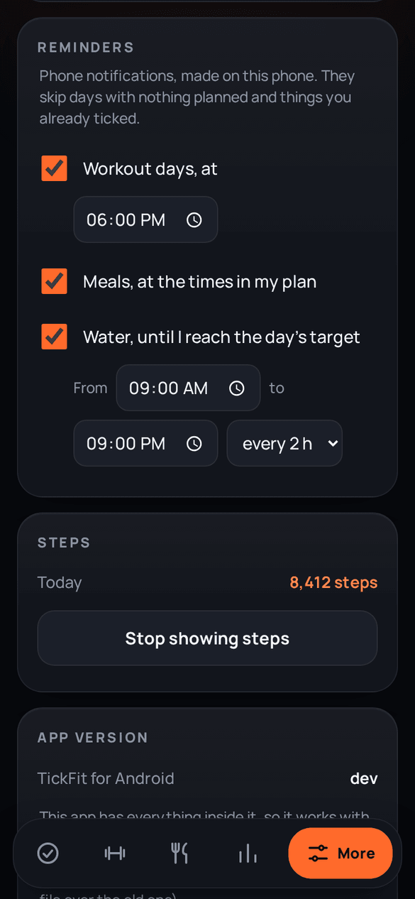
</p>

### Eat

- **Meals:** calories and protein meters, each meal as a big tick tile, supplements and water.
- **Calories and protein for any meal:** in the plan editor type them yourself, or tap **Estimate from foods**. It reads lines like `2 rotis`, `100 g paneer` or `1 or 2 bananas` against a built-in table of common Indian foods, fully offline. Optional: in **More > Food lookup** you can let it look up unfamiliar foods online (Open Food Facts, no key). Off by default; only the food name is sent.
- **Grocery list:** **Meals > Grocery list** adds up every food your meals need for the next 3, 7 or 14 days (`Roti × 14`, `Paneer 700 g`, `Milk 1.4 L`). Tick what you already have, then share or copy it.
- **Swap a meal:** the swap button on a meal shows the plan's other meals, closest in calories and protein first. One tap swaps it for that day only, with Undo.
- **Scan a packet:** in **Choose meals > Add your own meal**, **Scan a packet** reads the barcode with the camera (or you type its digits) and fills in the name, calories and protein from Open Food Facts. Only the barcode number is sent, and only after you say yes.

<p>
  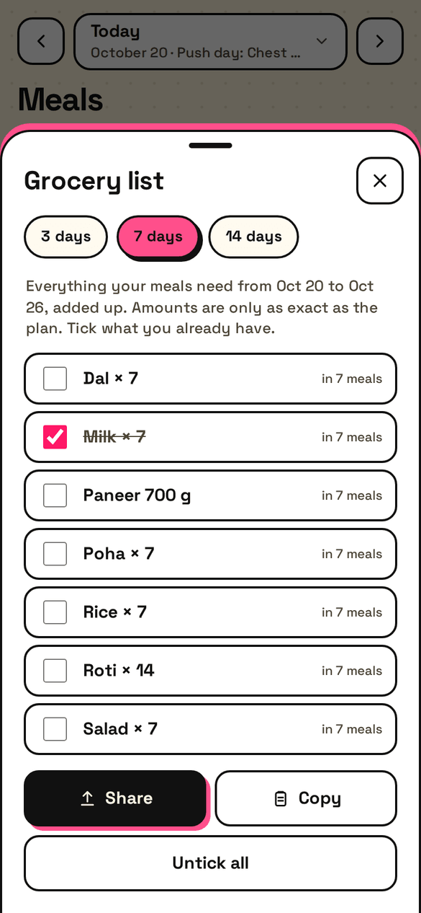
  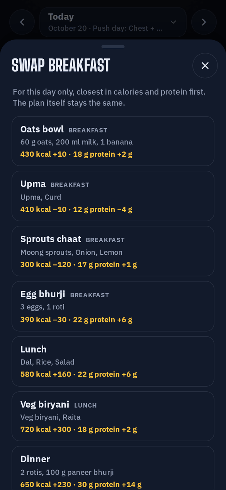
</p>

### AI assistant (optional)

- **Completely optional:** tick **More > AI helpers > Use AI helpers** to switch it on; untick to make every bit of AI disappear. TickFit works fully without it.
- **Bring your own key** from **OpenRouter** (one key for hundreds of models, many of them free), **OpenAI**, **Claude** or **Gemini**. Each has step-by-step instructions with links to the page where you make a key. After saving, TickFit fetches the models that key can use into a dropdown, with filters: **Free only**, by maker (meta-llama, deepseek, qwen, google...) and a search box. A new OpenRouter key starts on a good free model by itself.
- **A personal assistant:** the round **Ask AI** button on Today, Workout, Meals and Progress opens a chat. Ask it to summarise your week, review your progress or goal, swap or add exercises, make a day doable at home, change meals, calories, protein, water or workout time. It answers and proposes changes as plain sentences; **nothing changes until you tap Apply** (or Apply all), and Undo puts it back. Day changes only touch that day; plan-wide edits say so.
- **Your history stays yours:** a separate tick decides whether the assistant may see your last 2 weeks (ticks, sets, weight, steps).
- **Usage ran out?** TickFit waits and asks again by itself when your limit resets, and tells you when.

### Plans

- **Build a plan for you:** answer a few questions (age, height, weight, goal, experience, days a week, where you train, session length, cardio, diet, injuries). The diet can be the same every day, **Mixed** (your main diet with non-veg on a few evenly spread days), or **picked per day** (for example vegan Monday, egg Wednesday, non-veg Sunday) and TickFit builds a full weekly workout and Indian meal plan on your phone, with calories and protein worked out for you. No internet or AI needed.
- **Or bring any plan:** paste JSON, upload a PDF or text file, or let a free chatbot convert your document. Friendly errors tell you exactly what is wrong ("Day 3 is missing meals").
- **Mix and match each day:** tap **Choose exercises** or **Choose meals** on Today, Workout or Meals to pick what you do on that date. Filter by category (it starts on the day's focus, so "Friday Back Biceps" opens on back and biceps), search, tick what you want and **move it up or down** into order, add your own, or ask Claude or Gemini for **suggestions** if you set a key. **More > Exercise and meal library** lists everything you can add, by category, with one tap to add it to today. Pick from your plan's library, its other days, or TickFit's built-in exercise list. Only that date changes; **Use the plan's list** puts it back. If a plan only lists *options* (an AI often does this for "choose any 4" style plans), each day starts with a suggested pick from the options matching its name ("Wednesday Shoulders + Abs" gets shoulder and abs exercises), so no day turns into an accidental rest day.
- **Plans in one place:** **More > My plan** to switch, edit or add a plan. Switching keeps your history: TickFit offers to **bring in the progress** of your old plan, so your streak, calendar, summaries and lifting history carry on. Each past day keeps the exercises and meals it really had, with every tick and logged set, and nothing already logged is overwritten. **Bring in progress** on the active plan does the same any time. First-time visitors get a short welcome with three clear choices: build a plan for me, I already have one, or show me around with the sample.
- An **editor** for every exercise, meal and extra.
- A built in **4 week beginner plan with vegetarian Indian meals**, so it is useful on first open.

### Track your progress

- **Progress:** streak, last 7 day completion and a month calendar. Tap a day to open it.
- **Weekly and monthly summary:** estimated calories burnt, workouts, training time, sets, total weight lifted, a bar per day, comparison with the previous week or month, and daily averages for calories, protein and water. Total lifted comes with a desi fun comparison (a bag of atta, an LPG cylinder, a Royal Enfield Bullet, an auto rickshaw, a Maruti 800, an Indian elephant, a WAP-7 engine, the PSLV that sent Mangalyaan to Mars, all the steel in Howrah Bridge, up to INS Vikrant and past 100 million kg) and your next milestone. Each exercise shows its share of the calories and kcal per minute; the strength list shows your best set against your previous best, more reps at the same weight as a new best, an estimated 1 rep max and the weight moved. **Sets per muscle group** shows your balance and which big groups you skipped. Calories use the MET method (5 METs for lifting x your body weight x workout time), so treat them as a rough guess. Body weight comes from your plan builder answers, or set it right there.
- **Calories per exercise:** every exercise has an effort level (lifting about 5 to 6 METs, a run about 9, a walk about 4, stretching 2.5). TickFit estimates what each exercise burnt from that, your body weight and the time it took (timed work like "30 min" uses its real time; the workout clock is used when you finish). The finish summary shows the total and each exercise, and cardio gets its own line.
- **Correct the numbers yourself:** the calorie and time estimates are only a guess, so you can fix them. Tap **Edit** on a finished workout, or **Edit time and calories for a day** on the Progress tab (it lists the week or month, and also lets you add a workout you did without logging sets). Typed numbers win over the estimate and everything adds up to them. **More > Calories burnt: fine tune** moves all estimates down or up (−20%, −10%, As is, +10%, +20%) if your watch usually disagrees, with an example of what it does.
- **Daily weight tracker:** tap the Weight tile on Today to log your weight (big number, +/- 0.1 buttons). Progress shows a chart (30 or 90 days), your 7 day average and how much you gained or lost versus last week. The average matters more than any one day, because weight swings a kilo or two with water and food.
- **Body measurements:** waist, chest, hips, arms and thighs in cm on the Progress tab, with the change since you started. When the scale stalls, the tape often doesn't.
- **Progress photos:** on the Progress tab, **Take a photo** opens a camera with your last photo shown faintly on top (a "ghost"), so you line up the same pose, distance and angle every time; it has a 3, 5 or 10 second self-timer and a front/back switch. Or pick one **From gallery**. Swipe through them from the first (left) to the latest (right), each with its date along the bottom like a watermark, plus that day's weight and how many weeks in. **Compare** has a slider that wipes from your first photo to the latest (or puts them side by side) ("28 days apart, 2.8 kg down"). Tap one to change its date, **Save a copy** with the date written on it, or delete it. Photos stay on your phone; the backup file can carry them too (a tick box in the backup sheet).
- **Steps (Android app):** **More > Steps** reads your daily steps from Health Connect (where Google Fit, Samsung Health and most watches keep them) and shows them on Today. TickFit asks only to read step counts, nothing else. Needs Android 8.0 or newer.

<p>
  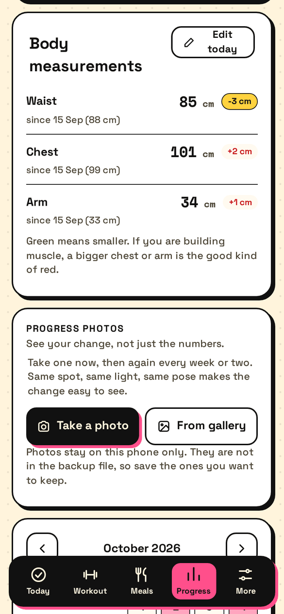
  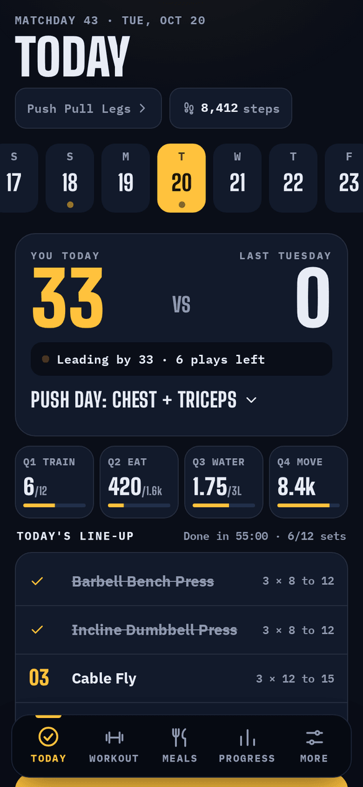
</p>

### Share

- **Share a plan with a friend:** **More > My plan > Share** shows a QR code and a link. Your friend scans it with their phone camera (or opens the link) and TickFit asks to add the plan. The whole plan travels inside the link, with no server and no account; never your progress, weights or photos.
- **Share your workout:** after **Finish workout**, **Share this workout** makes a picture in your look (time, sets, kg lifted, calories, a desi comparison, top sets, new bests) for Instagram stories or WhatsApp.

<p>
  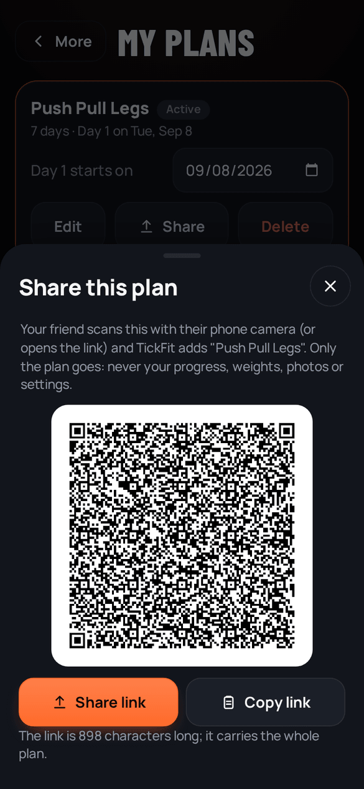
  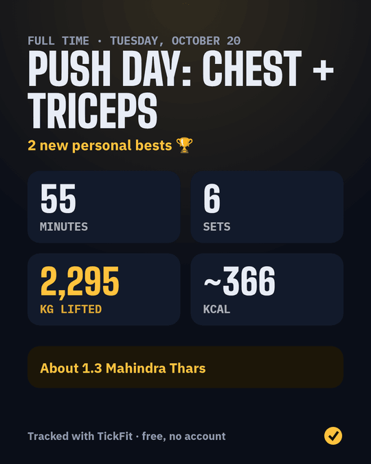
  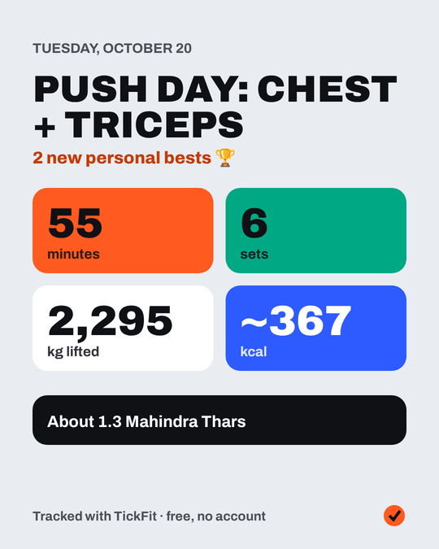
  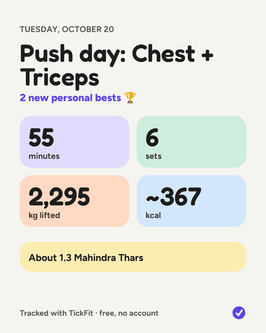
</p>

### Your data, kept safe

- **Keeps your data safe:** asks the browser to protect your data, nudges you to back up once a day (one tap, also offered after a workout, with a red dot on More when it is overdue), and makes moving to a new phone easy (see below).
- **Automatic backup (Android app):** once a day TickFit saves a backup in the phone's `Documents/TickFit` folder and keeps the last 7. That folder survives uninstalling the app; sync it with Google Drive to be safe from losing the phone. Switch it off or include photos in **More > Your data**.
- **Last backup you can trust:** on Android, some apps (like Drive's "Save to Drive" box) never tell TickFit whether they saved the file, so it asks you, and **Last backup** only changes when the file really was saved.
- **After a workout**, a pop-up offers to back up your progress (once a day, and you can turn it off in More).
- **Undo:** deleting a plan, a day, a photo or a library item, ticking every set at once, going back to the plan's list or restoring a backup all show an **Undo** button for a few seconds.
- **Export to a spreadsheet:** **More > Your data > Export to a spreadsheet** gives a CSV with one row per day (done %, sets, volume, calories, protein, water, weight, steps, measurements, notes) or one row per logged set. It opens in Google Sheets, Excel or LibreOffice.

### Two looks

- **Three looks, one tap apart** (More > Look), each laid out its own way, not just recoloured: **Arena** (deep navy, scoreboard yellow, stadium numbers, monospace labels, a shot clock for rest and a play by play of your sets), **Deck** (solid colour cards, wide heavy type, a big card for each set with the barbell drawn, and a full screen rest that drains as it runs) and **Bento** (pastel tiles, rounded type, pill buttons, no outlines). Each has dark, light and match-my-phone themes, and the workout picture and home screen widgets follow too. The fonts are bundled with the app (SIL Open Font License, see `fonts/`), so nothing is fetched from font services. Smooth, quick animations (numbers that count up, Deck cards that fly off and rise into place, confetti when you finish a day) that switch off if your phone is set to reduce motion. Works offline after the first load.

## Privacy

Everything stays on your device. There is no server to send anything to. See [PRIVACY.md](PRIVACY.md) for the details, including the optional AI helpers (OpenRouter, OpenAI, Claude or Gemini, with your own key) that send what you ask about to the provider you pick, only if you switch them on.

## How to use it

1. **Open the app.** First time, pick how to start: **Build a plan for me**, **I already have a plan**, or **Just show me around** (a 4 week sample).
2. **Train.** On **Today** tap **Start workout**. Tick each set as you do it. When you finish an exercise the next one opens. Tap **Finish workout** for your summary.
3. **Eat.** Tick meals off on the **Meals** tab, and tap **+** on the water tile through the day.
4. **Check your progress** on the **Progress** tab, and use **More** to switch between Arena, Deck and Bento, manage plans, backups and settings.

### Install it on your phone

- **Android app (APK):** download the latest from the [Releases page](https://github.com/PredatorWoah/TickFit/releases/latest) once; after that it **updates itself** (it says when a new version is ready, then downloads, checks and installs it in a tap or two, keeping your data). A complete app with everything inside it, so it works with no internet, plus twelve **home screen widgets**: six kinds, each in an Arena and a Bento version you pick from the widget list (day rings, today, next exercise with a live clock, water with a + button, streak and week, weight lifted). How it is made: [docs/ANDROID.md](docs/ANDROID.md).
- **iPhone (Safari):** Share button, then **Add to Home Screen**.
- **Android (Chrome):** menu, then **Install app** (or **Add to Home screen**).

After that it opens full screen and works without internet. On an iPhone this also matters for your data: Safari can erase a website's data after about a week of not opening it, but an installed app is safe from that.

## Your data: where it lives and how not to lose it

TickFit stores everything in your browser on your phone. That is what makes it private, free and offline. It also means there is no account to recover from, so:

- **Install it** to your Home Screen (see above). Installed apps are far less likely to have their data cleared.
- **Back up daily.** A web page cannot save files by itself (no browser allows it), so TickFit makes it as easy as possible: a reminder on Today once a day, a one tap **Back up now** sheet, and a red dot on the More tab when your backup is 3 days old. In the sheet you can rename the file, share it (save to Files or Drive, send it on WhatsApp or email) or download it. Android and iPhone cannot overwrite an old file, so a repeated name becomes "name (1)"; desktop Chrome and Edge can use **Save over an existing file**.
- **New phone?** Make a backup on the old phone, open the same link on the new one, then **More > Restore from a backup file**. Your AI keys (if you set any) are never in the backup, on purpose.
- **Two devices do not sync.** Without a server that isn't possible, so each device keeps its own history.

## Build a plan from your details

**More > My plan > New plan > Build one for me.** You answer about a dozen taps and numbers, see a preview (daily calories and protein, the week, a sample workout), and then create the plan.

How it works, so you can judge it:

- **Calories:** your resting energy from the Mifflin-St Jeor formula, multiplied for how active you are and how often you train, then adjusted for your goal (about 20% less to lose fat, a small surplus to build muscle). It never goes below 1,200 kcal (women) or 1,500 (men) for fat loss, and it holds calories at maintenance instead of cutting them if you are under 18 or your BMI is low.
- **Protein:** about 1.4 to 2 g per kg depending on the goal, from a sensible reference weight.
- **Workouts:** a split that fits your days (full body, upper/lower, push/pull/legs), exercises chosen for your equipment, with beginner-friendly picks first (leg press before barbell squats). Bad knees, lower back or shoulders remove the exercises that stress them.
- **Meals:** Indian home cooking for vegetarian, eggetarian, non-veg or vegan eaters, with portions sized so each meal's calories and protein add up. The meals are real estimates of typical home portions, not lab values.
- **It is a starting point.** You can edit every exercise and meal afterwards. This is general guidance, not medical advice: if you have a medical condition, are pregnant or are recovering from an injury, check with a doctor first.

Prefer to let a chatbot design it? **Or copy a prompt for a chatbot** copies the same details as a ready prompt.

## The AI prompt workflow (for your own documents)

You do not need to write JSON by hand. Any free chatbot can convert a plan document for you:

1. In TickFit, open **More > New plan > Paste or upload a plan** and tap **Copy AI prompt**.
2. Open any chatbot (ChatGPT, Gemini, Claude, Copilot, anything free). Paste the prompt, then paste your plan document under it. For a PDF from your trainer or dietitian, tap **Upload PDF or text** in TickFit to extract its text on your phone, then **Copy prompt with this text**.
3. The chatbot replies with JSON. Copy the whole reply.
4. Paste it into TickFit's box and tap **Import plan**. Stray text and code fences around the JSON are handled for you.

If something is wrong, TickFit lists every problem in plain language. Paste that back to the chatbot and ask it to fix it.

**Optional one tap version:** tick **More > AI helpers > Use AI helpers**, pick OpenRouter (it has free models), OpenAI, Claude or Gemini and paste your own key (each one has a "How to get a key" with links). Then **Convert with AI** replaces the copy and paste, and **Suggest exercises / meals** appears in the Choose sheet. Read the notes on that screen first: what you ask about is sent to the provider you pick, and the key is stored (unencrypted) on your device.

## Plan format

Plans are plain JSON. Rest days have an empty `workout` list.

```json
{
  "name": "Beginner Muscle Plan",
  "days": [
    {
      "label": "Monday Push",
      "workout": [
        { "exercise": "Bench Press", "sets": 3, "reps": "8 to 10", "rest": "90s", "weight": "20 kg", "notes": "", "video": "https://youtu.be/example" }
      ],
      "meals": [
        { "time": "8:00 AM", "name": "Breakfast", "items": ["Paneer bhurji", "2 rotis"], "calories": 450, "protein": 25 }
      ],
      "extras": { "waterLiters": 3, "supplements": ["Creatine 5g"], "notes": "" }
    },
    {
      "label": "Tuesday Rest",
      "workout": [],
      "meals": [{ "name": "Breakfast", "items": ["Poha"] }]
    }
  ]
}
```

| Field | Required | Notes |
| --- | --- | --- |
| `name` | no | Defaults to "Imported plan" |
| `days[].label` | no | Defaults to "Day N" |
| `days[].workout` | **yes** (unless there is a `library`) | `[]` for a rest day |
| `days[].meals` | **yes** (unless there is a `library`) | Can be `[]` |
| `workout[].exercise` | **yes** | `sets`, `reps`, `rest`, `weight`, `notes`, `video` are optional |
| `workout[].weight` | no | A target like `"20 kg"` or `"bodyweight"`. Pre-fills the weight in the set sheet |
| `workout[].video` | no | A web link (`https://...`). Anything else is ignored with a warning |
| `meals[].name`, `meals[].items` | **yes** | `time`, `calories`, `protein` are optional |
| `extras` | no | `waterLiters`, `supplements` (list), `notes` |
| `days[].focus` | no | Library categories the day is about, like `["Back", "Biceps"]`. The day picker starts filtered on them. Without it, categories named in the label count |
| `library` | no | Exercises and meals to choose from on any day, grouped by category (see below) |

### A library to mix and match from

List everything you might do by category, and choose each day in the app. With a library, days may leave out `workout` and `meals`, and `days` itself is optional (you get one open day to fill).

```json
{
  "name": "My gym list",
  "days": [{ "label": "Friday Back Biceps" }, { "label": "Monday Chest Triceps" }],
  "library": {
    "exercises": {
      "Back": ["Lat Pulldown", { "exercise": "Seated Cable Row", "sets": 4, "reps": "10" }],
      "Biceps": ["Hammer Curl", "Barbell Curl"],
      "Chest": ["Bench Press"]
    },
    "meals": {
      "Breakfast": [{ "name": "Oats bowl", "items": ["60 g oats", "1 scoop whey"] }, "Poha"],
      "Dinner": [{ "name": "Dal rice", "items": ["Dal", "Rice"], "calories": 550, "protein": 20 }]
    }
  }
}
```

An item can be just a name or a full exercise or meal. A plain list where each item has a `"category"` works too, and so do top-level `"exercises"` and `"meals"` instead of `"library"`. What you pick is saved per date in the plan (and in backups).

There are two kinds of plan:

- **Cycle (default):** Day 1 is your start date, Day 2 the next day, and so on, repeating after the last day. The built in sample works like this.
- **Weekly:** if **every** day label starts with a weekday (`"Monday Chest + Triceps"`, `"Tue: Back"`), the plan follows the real calendar instead. A Monday shows the Monday entry, and weekdays you don't list (say Sunday in a Monday to Saturday plan) are rest days. No start date is needed, and a 6 day plan no longer drifts. Plans built by the builder are weekly plans.

Rest days with nothing to tick never break your streak. The `reps` text decides how an exercise is logged: a rep count like `8 to 10` gives weight and reps boxes, a timed one like `30 sec` or `30 min` gives a simple tick. The `rest` text feeds the timer: `90s`, `2 min`, `1:30` and `60 to 90s` all work.

The importer is forgiving: it accepts code fences, chatty text around the JSON, trailing commas, curly or single quotes, unquoted keys, and numbers written as text.

## Fork it and make it yours

There is no build step, so forking is easy:

1. Click **Fork** on GitHub.
2. Edit files right in the GitHub web editor, or clone and open the folder in any editor.
3. Change the colours in `css/styles.css`, the sample plan in `data/sample-plan.json`, the name in `index.html` and `manifest.webmanifest`, and the icons in `icons/`.
4. Host it (below).

To run it on your computer: `python3 -m http.server 8000`, then open http://localhost:8000. (Opening `index.html` directly will not work, because browsers block modules and service workers on `file://`.)

## Host it free on GitHub Pages

**Easiest (works in any fork, no setup files needed):**

1. Fork this repo.
2. Go to **Settings > Pages**.
3. Under **Build and deployment**, set **Source** to **Deploy from a branch**, branch **main**, folder **/ (root)**, and save.
4. After a minute your app is at `https://YOUR-USERNAME.github.io/REPO-NAME/`.

**With GitHub Actions** (this repo's own setup): in **Settings > Pages**, set **Source** to **GitHub Actions**. The workflow in `.github/workflows/pages.yml` then runs the tests and deploys on every push to `main`.

All paths in the app are relative, so it works under any `/REPO-NAME/` address.

## Updates (why a deploy shows up straight away)

GitHub Pages lets browsers keep each file for 10 minutes, so a plain refresh could show the old app (or a mix of old and new files) for a while after a deploy. To avoid that, the deploy workflow runs `node scripts/stamp.mjs`, which adds the commit ID to every file URL in the `_site` copy (`app.js?v=abc1234`). Your source files are never changed. The service worker also asks the server before reusing a file, an installed app that is resumed (not reloaded) gets a "TickFit has a new version, Reload" bar, and **More > App version > Update TickFit now** forces the newest files without touching your data.

## Tests

```
node tests/all.mjs
```

No installs needed. It covers the plan importer (valid, messy and broken inputs), weekday scheduling, streaks, set logging, rest-time parsing, the backup reminder logic, the weekly and monthly summaries, calorie burn, note formatting, mixed and per-day diets, the body weight maths, the food estimate and the opt-in lookup (with a faked network), the offline file list, and the plan builder: the builder test generates **2,700 plans across every combination of answers** and checks each one is valid, uses only the equipment you have, avoids exercises that stress your injuries, respects your diet, stays close to its calorie target and varies day to day. See [CONTRIBUTING.md](CONTRIBUTING.md).

## Contributing

Small, focused changes are welcome. Please read [CONTRIBUTING.md](CONTRIBUTING.md) first (the short version: no build step, no tracking, phone first, comment for beginners).

## Credits and license

[MIT](LICENSE). PDF reading uses a bundled copy of [pdf.js](https://github.com/mozilla/pdf.js) (Apache-2.0), see `vendor/pdfjs/`.

TickFit is not medical advice. Check your plan with a qualified professional.
